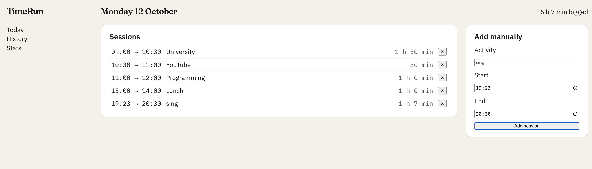

# TimeRun

A time-tracking web app that shows you where your time actually goes.

**Live demo:** https://timerun.vercel.app/ 



## Why I built it

I wanted to see how I actually spend my days, and the time-tracking apps I found were either expensive or didn't work the way I wanted. It's also a personal project, outside my studies, to learn React and JavaScript by building something I use myself.

## Features

- Log sessions with an activity, start time and end time
- See each session's duration and the total time logged today
- Input validation (no empty fields, end time must be after start)
- Delete sessions
- Sessions are saved in the browser (localStorage), so they're still there after a refresh

## Built with

- React
- JavaScript
- Vite
- CSS (Flexbox)
- Deployed on Vercel

## How to run locally

```bash
git clone https://github.com/bansalkreya-ux/TimeRun.git
cd TimeRun
npm install
npm run dev
```

Then open the `localhost` link shown in the terminal.

## Roadmap

- [x] Add, delete and validate sessions
- [x] Durations and daily total
- [x] Save data between visits
- [] Live start/stop timer
- [ ] Timeline of the day
- [ ] Activities with colors
- [ ] Backend with user accounts and PostgreSQL
- [ ] Weekly statistics and insights
